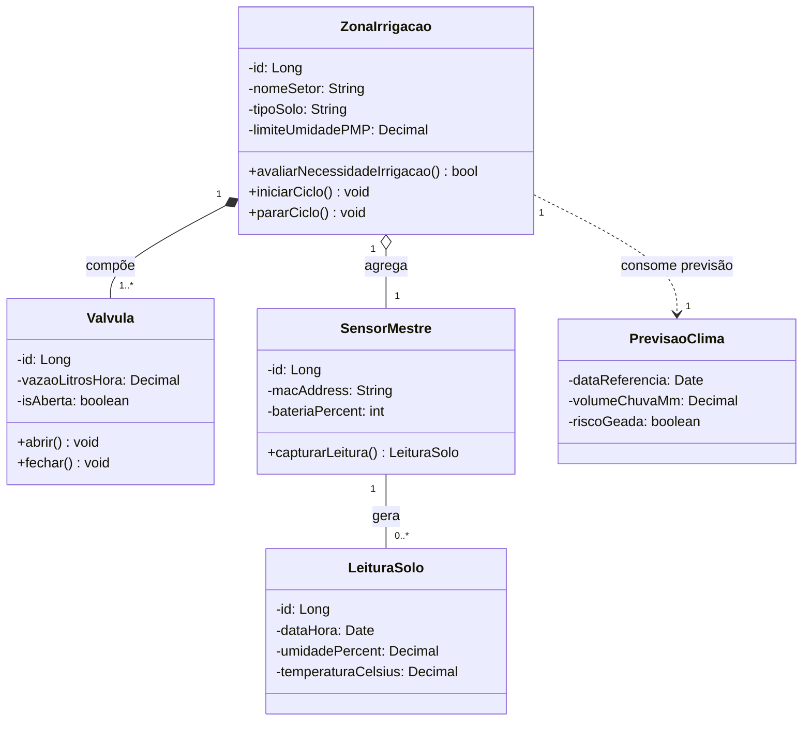
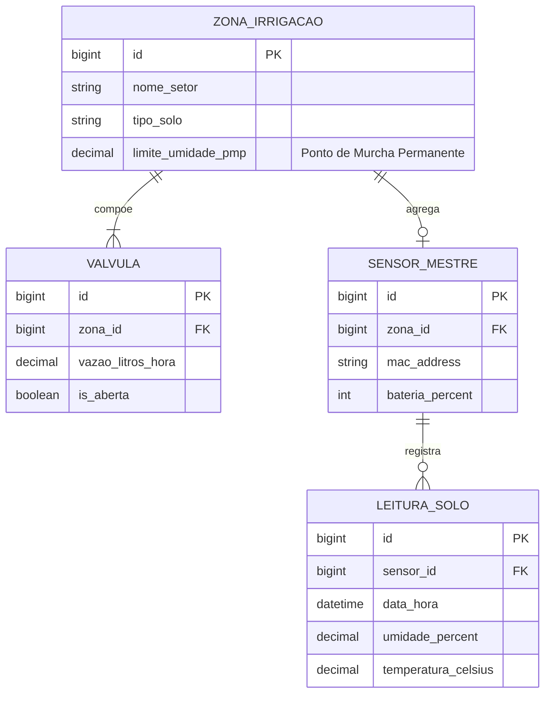
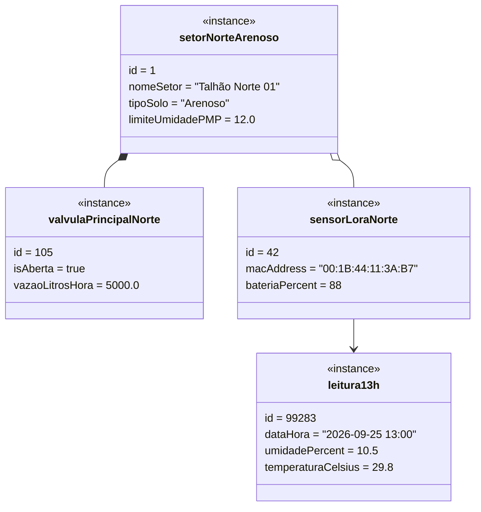

# Diagramas Estruturais: Sistema IoT de Monitoramento Agrícola

Este documento materializa a modelagem de dados e objetos da solução definida (Malha Macro-Setorizada com Inteligência Preditiva), seguindo as diretrizes estruturais de projeto (DDD e Modelagem Relacional).

## 1. Diagrama de Classes
Este diagrama ilustra a estrutura do domínio, evidenciando a **Composição** (A válvula é parte intrínseca da zona de irrigação e controlada por ela) e a **Agregação** (O sensor mestre está alocado em uma zona, mas tem um ciclo de vida independente, podendo ser trocado de lugar ou substituído).

## 2. Diagrama Entidade-Relacionamento (DER)
O DER foca na camada de persistência. Observe como as classes do diagrama acima foram mapeadas para tabelas relacionais, estabelecendo Chaves Primárias (PK) e Estrangeiras (FK). As instâncias temporais (Previsão do Clima) muitas vezes não são persistidas permanentemente como entidade, servindo apenas para tomada de decisão em tempo real.

## 3. Diagrama de Objetos (Snapshot em Tempo de Execução)
Aqui temos uma instância real ("fotografia") do sistema em operação. O talhão arenoso atingiu uma umidade crítica (abaixo do seu limite) e a válvula correspondente está ativada.

