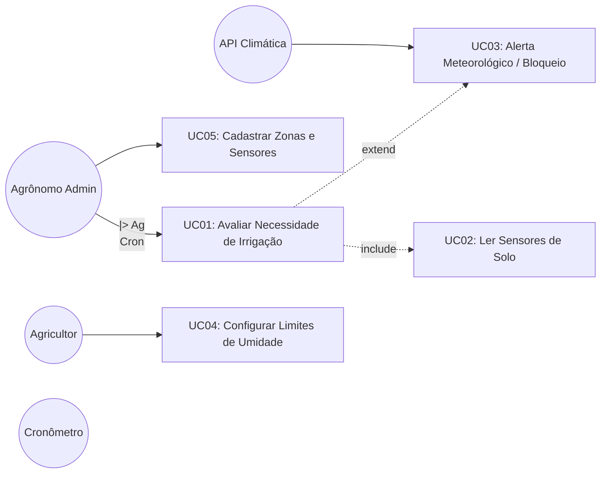

# Requisitos e Especificações Complementares

Este documento surge do ciclo de **Auto-Correção (Self-Correction Loop)** para garantir a cobertura de 100% dos 15 itens exigidos pela especificação técnica (`SKILL.md`), cobrindo de forma estrita as lacunas identificadas na fase inicial de exploração.

## 1. Tabela de Requisitos Funcionais e Não Funcionais (Checklist Item 1)

| ID | Descrição | Prioridade | Ator/Origem |
|----|-----------|------------|-------------|
| **RF01** | O sistema deve ler a umidade do solo (via Sensor) periodicamente. | Alta | Cronômetro |
| **RF02** | O sistema deve buscar a previsão do tempo via API externa. | Alta | Sistema |
| **RF03** | O sistema deve acionar a Válvula caso a umidade seja menor que o PMP e não haja previsão de chuva. | Alta | Sistema |
| **RF04** | O sistema deve registrar e propagar o estado "Em_Falha" se a válvula física não responder. | Alta | Válvula |
| **RNF01** | **Disponibilidade**: Os sensores devem operar em modo Polling para economia de bateria (Mín. 12 meses). | Alta | Infraestrutura |
| **RNF02** | **Confiabilidade**: O timeout de comunicação atuador/válvula não pode exceder 5 segundos de latência. | Crítica | Segurança |

## 2. Diagrama de Casos de Uso (Checklist Item 2)
Diagrama visual mapeando os atores (incluindo o Cronômetro autônomo), a herança e as associações condicionais.

## 3. Descrição Textual dos Casos de Uso (Checklist Item 3)

**UC01: Avaliar Necessidade de Irrigação**
- **Ator Primário:** Cronômetro / Tempo
- **Pré-condições:** O Sensor Mestre da zona precisa estar online e a Válvula não pode estar no status `Em_Falha`.
- **Fluxo Principal:** 
  1. O ator Cronômetro desperta e engatilha a checagem da Zona de Irrigação.
  2. O Sistema invoca compulsoriamente o UC02 (Ler Sensores).
  3. O Sistema cruza a leitura atual com o Ponto de Murcha Permanente (PMP).
  4. O Sistema aciona a Válvula.
  5. A Válvula confirma abertura.
- **Fluxo Alternativo (Extensão):** Se a avaliação inicial detectar solo seco, o sistema aciona a previsão. Se houver chuva severa prevista, o UC03 entra em ação, bloqueia o comando da válvula e altera o log.
- **Pós-condições:** O ciclo de irrigação é executado com segurança (ou postergado intencionalmente) e persistido no Repositório.
- **Rastreabilidade (Origem):** Atende aos requisitos **RF01**, **RF02**, **RF03**, **RF04**.

## 4. Marcação de Persistência das Entidades (Checklist Item 5)
Complementando o Diagrama de Classes e o DER do nosso levantamento inicial, abaixo especificamos a estratégia tática de persistência das entidades via ORM.

| Classe (Entidade) | Persistente? | Estratégia de Mapeamento (Banco SQL) | Observação |
|-------------------|--------------|--------------------------------------|------------|
| `ZonaIrrigacao`   | Sim          | Tabela `zona_irrigacao`, PK `id` | Raiz do Agregado. Tabela pai das demais. |
| `Valvula`         | Sim          | Tabela `valvula`, FK `zona_id` | **Composição:** Excluída em cascata (`ON DELETE CASCADE`) se a Zona for removida. |
| `SensorMestre`    | Sim          | Tabela `sensor_mestre`, FK `zona_id`| **Agregação:** A FK pode ser nula caso o sensor esteja em manutenção no estoque. |
| `LeituraSolo`     | Sim          | Tabela `leitura_solo`, FK `sensor_id`| Volume alto de inserções (Histórico temporal). |
| `PrevisaoClima`   | Não          | *N/A (Transient)* | Apenas consumida na memória como DTO para o fluxo de bloqueio climático. |

## 5. Matriz de Rastreabilidade Ponta a Ponta (Checklist Regra Final)
Conforme as regras estruturais da `SKILL.md`, garantimos que todo requisito nasça, seja modelado, estruturado e testado sem pontas soltas:

| Requisito Funcional | Caso de Uso Vinculado | Modelagem Dinâmica (BCE / Sequência) | Modelagem Estrutural (Entidades) | Plano de Testes (Aceitação/TDD) |
|---------------------|-----------------------|--------------------------------------|----------------------------------|---------------------------------|
| **RF01** (Ler Solo) | UC01, UC02 | Mapeado no `AvaliarIrrigacaoUseCase` | `SensorMestre`, `LeituraSolo` | TDD Unidade: Lançar Exceção VO |
| **RF02** (API Clima)| UC01, UC03 | Mapeado no `ClimaAdapter` (Fronteira) | `PrevisaoClima` (Transiente) | TDD Unidade: Domain Service |
| **RF03** (Acionar)  | UC01 | Mapeado no `AvaliarIrrigacaoUseCase` | `ZonaIrrigacao`, `Valvula` | TDD Aplicação (Fakes) |
| **RF04** (Em Falha) | UC01 | Mapeado no `AvaliarIrrigacaoUseCase` | `Valvula` | TDD Aplicação (Fakes) |
