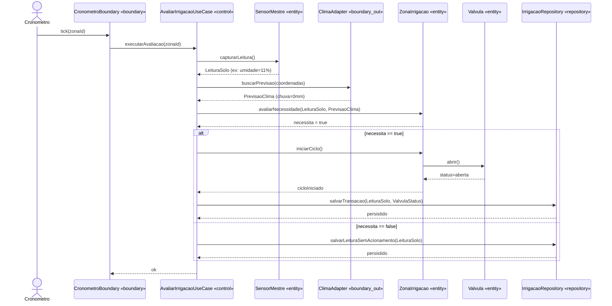
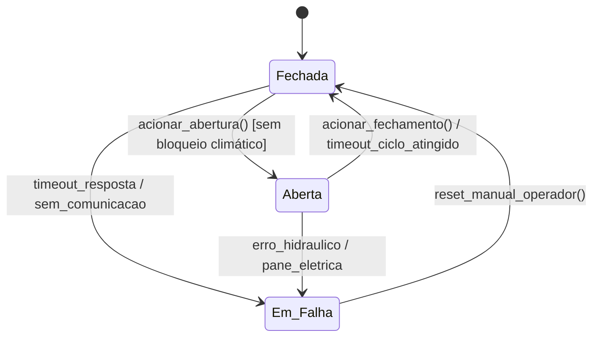
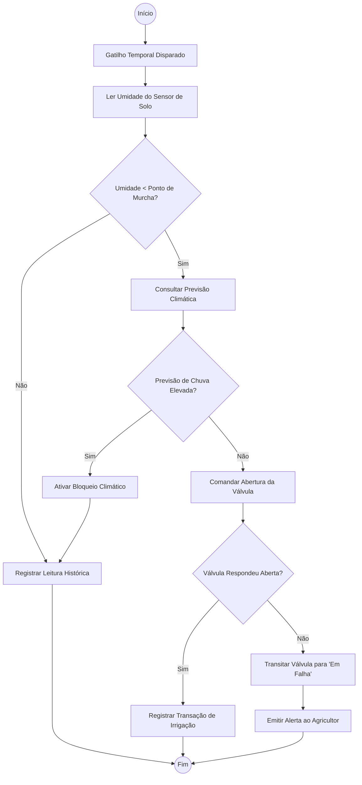
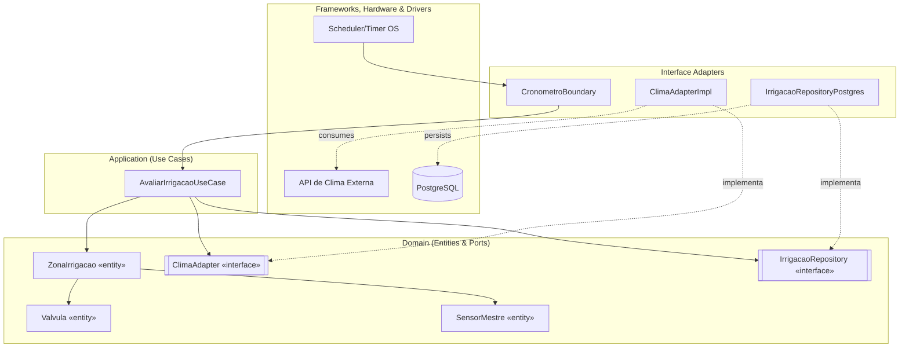

# Modelagem Dinâmica: Sistema IoT de Monitoramento Agrícola

Este documento acompanha a construção evolutiva da arquitetura do sistema utilizando a técnica de prompt chaining. A saída de cada etapa servirá de base estrutural para a modelagem da etapa seguinte.

## Passo A: Boundary-Control-Entity (BCE) e Diagrama de Sequência
O foco desta primeira etapa é mapear o fluxo do caso de uso mais crítico do sistema: **Avaliar Necessidade e Acionar Irrigação**.

### 1. Tabela BCE (Fronteira, Controle, Entidade)
A tabela abaixo reclassifica as classes geradas na etapa de exploração para preparar a adoção da Clean Architecture.

| Caso de Uso | Boundary (Fronteira) | Control (Casos de Uso/Aplicação) | Entities (Domínio/Infraestrutura) |
|-------------|----------------------|----------------------------------|-----------------------------------|
| Avaliar Necessidade e Acionar Irrigação | `CronometroBoundary` (Gatilho In), `ClimaAdapter` (Saída API) | `AvaliarIrrigacaoUseCase` | `ZonaIrrigacao`, `SensorMestre`, `LeituraSolo`, `Valvula` |

### 2. Diagrama de Sequência: Acionamento de Irrigação
O diagrama abaixo utiliza o output da tabela BCE para demonstrar a ordem cronológica e síncrona das mensagens na execução do fluxo autônomo. O gatilho temporal orquestra a leitura, valida o clima, aciona a entidade de domínio e salva o log de persistência.

## Passo B: Diagrama de Estados e Diagrama de Atividades
Com base nas decisões orquestradas pelo `AvaliarIrrigacaoUseCase` no Passo A, modelamos o ciclo de vida do nosso componente atuador e o fluxo algorítmico do sistema.

### 1. Diagrama de Estados: AtuadorValvula
A válvula possui um ciclo de vida finito, transitando entre três estados. O estado "Em Falha" é crucial para acionar alertas de hardware e evitar que a bomba hidráulica queime ou que a plantação sofra danos.

### 2. Diagrama de Atividades: Orquestração do Acionamento
Este fluxo detalha a inteligência de controle mapeada no Diagrama de Sequência (condicionais if/else "alt"). Ele demonstra os "branches" de decisão baseados na predição climática e na leitura física.

## Passo C: Diagrama de Componentes (Clean Architecture)
Finalizando a cadeia estrutural, utilizamos o mapa de atores do Passo A e as camadas lógicas (Fronteira, Controle, Entidade) para consolidar fisicamente a **Clean Architecture**. O diagrama evidencia a Regra de Dependência (setas apontando sempre para o núcleo de Domínio) e a Inversão de Dependência via *Ports & Adapters*.

